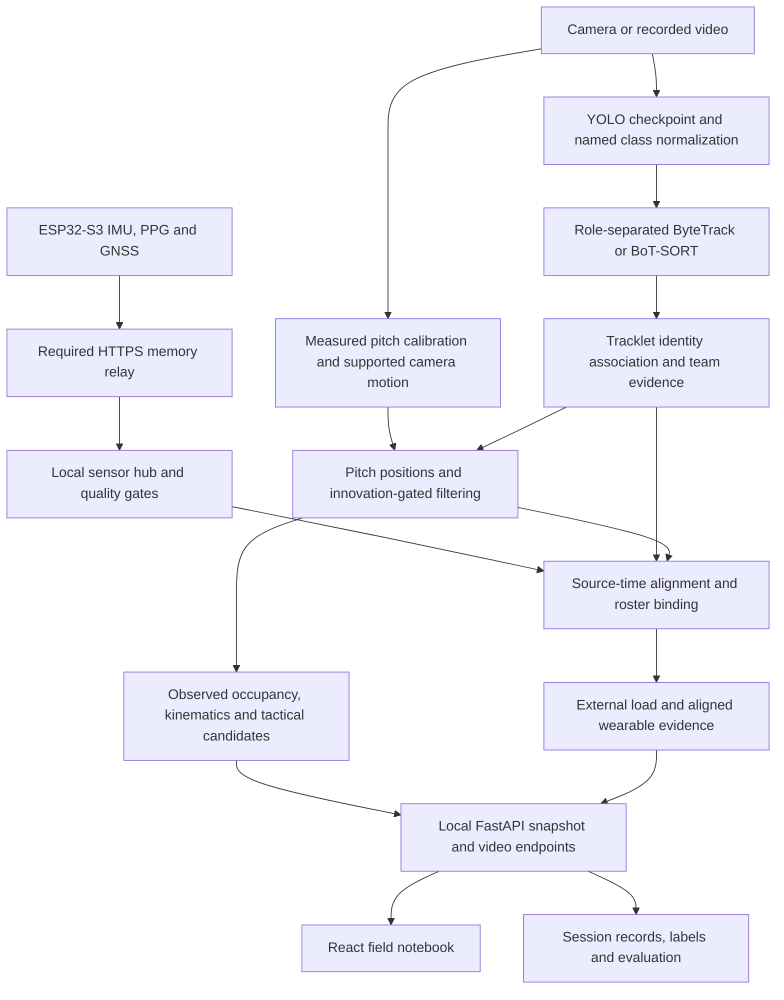

# CPG44 project atlas

Source review: 11 November 2026. This describes the active root application and
the changes made during the research pass. It does not treat reference demos or
synthetic evaluations as campus accuracy evidence.

## Objectives and supported system

The approved objectives in `mid_sem_submission_2026/report/chapters/chapter1.tex`
are integrated vision/wearable processing, physiological and spatial sensing,
performance/tactical modelling, and evaluation on public and controlled data.
The stated scope is one calibrated camera, known kits, a prepared roster,
ESP32-S3 wearables, local compute, and the required memory-only remote relay.

## Which directories matter

| Directory | Role |
|---|---|
| `soccer_analytics/` | Active vision, geometry, analytics, fusion and job orchestration |
| `backend/src/cpg44_api/` | Active product API, snapshot store, tagging, training and flashing |
| `frontend/` | Active React/Vite application |
| `firmware/wearable_stream/` | Supported ESP32-S3 firmware |
| `scripts/`, `configs/` | Launch, training, calibration and diagnostic entry points |
| `tests/` | Active regression suite |
| `data/`, `runs/`, `demo/`, `demo_out/` | Runtime data, learned artifacts and example evidence |
| `reference_capstone/` | Separate multi-camera architecture reference; its synthetic scores do not validate this implementation |
| `football-intelligence-system/` | Separate video-analytics/Streamlit reference project, not the active React backend |
| `proposal_report/`, `mid_sem_submission_2026/` | Objective and report evidence |
| `mid_sem_report_guide/`, `midsem_presentation/`, `presentation_deck/` | Academic submission and presentation material |
| `docker/`, compose files | Deployment descriptions; runtime correctness still needs separate verification |

The generated [source inventory](research/2026-11-11/project-map.json) records
imports, functions/classes with line numbers, API routes, frontend routes,
source hashes, and root directories. Regenerate it with
`python scripts/map_project.py`. It intentionally excludes secrets, datasets,
model binaries, and reference trees.

## Active module map

| Area | Files | Responsibility and boundary |
|---|---|---|
| Contracts | `core.py`, `config.py`, `loadtypes.py` | Canonical detection roles, arrays, pitch geometry and workload types |
| Compute | `device.py`, `tracker.py` | Device/precision selection, checkpoint class mapping, detector, low-score recovery, role-isolated trackers and ball ROI search |
| Geometry | `view.py`, `pitch.py`, `calibrate.py` | DLT and line/circle calibration, manual landmark workflow, optical-flow/ORB propagation and projection validity |
| Identity | `reid.py`, `team_assign.py`, `jersey_ocr.py` | One-to-one lost-track assignment, kit evidence, abstention, OCR votes and roster/wearable binding |
| Position | `filters.py` | Per-track state, elapsed-time prediction, innovation rejection and covariance maintenance |
| Analysis | `metrics.py`, `tactics.py`, `tactical_engine.py` | Track histories, possession/pass/restart heuristics, visible team shape and nearest-player spatial control |
| Coaching | `pass_prediction.py`, `shots.py`, `substitution.py`, `catapult.py` | Geometric pass options, shot/xG heuristic, load summaries and explained review prompts |
| Forecasting | `trajectory.py` | Optional learned image-space trajectory forecasting; forecasts are not measured occupancy |
| Rendering | `annotate.py`, `heatmap.py`, `dashboard.py` | Video labels, metric pitch, occupancy grids and optional OpenCV display |
| Execution | `realtime.py`, `pipeline.py`, `modes.py`, `hub.py` | Streaming execution, offline two-phase analysis, subprocess jobs and legacy orchestration |
| Training/evaluation | `train.py`, `data_split.py`, `evaluation.py` | Detector training, deterministic sequence splits, and metric-space diagnostics |
| Sensor input | `sensors/hub.py`, `hub_bridge.py`, `server.py`, `source.py`, `schema.py` | Relay consumption, raw processing, transport interfaces, units and timestamped samples |
| Sensor inference | `sensors/ppg.py`, `gps_pitch.py`, `sync.py`, `fusion.py` | Optical processing, surveyed GPS conversion, clock/identity alignment and load fusion |
| Decision support | `sensors/injury.py`, `sensors/recommend.py` | Transparent workload review and optional outcome-labelled models, with evidence requirements |
| API state | `cpg44_api/main.py`, `store.py` | Routes, WebSocket/MJPEG, current/recorded provenance and source freshness |
| API services | `training_manager.py`, `tagger.py`, `flasher.py`, `usb_bridge.py`, `hostinger_sensor_relay.py` | Training jobs, operator corrections, hardware setup and memory-only relay |

## Frontend routes (12 Nov 2026 overhaul)

| Route | Source | Purpose |
|---|---|---|
| `/` | `SessionPage.tsx` | Session board: readiness runbook read from the live system, recent analyses, house rules |
| `/prepare/camera` | `CameraCheckPage.tsx` | Pre-kick-off camera check (`/api/v1/camera-check`, `camera_check.py`) |
| `/prepare/calibrate` | `PlayerTaggingPage.tsx` | Pitch calibration and kit colours |
| `/squad` | `PlayerMappingPage.tsx` | Squad and vest pairing |
| `/live` | `LivePage.tsx` | Live touchline, now with `coach_insights` from the live coach engine |
| `/review/:id` | `ReviewPage.tsx` | Match review: footage, board (moment/shape/heat/pass links/3D), match strip, findings, Your call queue, players, side by side |
| `/ingest` | `MatchUploadPage.tsx` | Upload a recording (runs `match_analysis`) |
| `/vest`, `/vest/setup` | `WearablePage.tsx`, `HardwareFlasherPage.tsx` | Vest readings and flashing |
| `/evidence` | `EvidencePage.tsx` | Evidence ledger built from `data/benchmarks/*.json` |
| `/workshop/*` | training, cameras, runtime | Rarely used setup tools |

Earlier addresses (`/recordings`, `/analytics`, `/tagging`, …) redirect.
New components: `BoardPitch.tsx`, `MatchStrip.tsx`, `Replay3D.tsx` (three.js),
`PlayerCard.tsx`. Visual system: `theme.css`; rationale in
[DESIGN_RATIONALE.md](DESIGN_RATIONALE.md).

## Modules added in the 12 Nov 2026 accuracy pass

| Module | Role | Evidence |
|---|---|---|
| `mot_eval.py` | HOTA/IDF1/MOTA (TrackEval-equivalent procedure) | unit tests |
| `imm_tracker.py` | IMM/CV Kalman, uncertainty-adaptive expansion IoU, masked camera-motion compensation, BYTE two-stage, appearance veto | [TRACKING_BENCHMARK.md](TRACKING_BENCHMARK.md) |
| `reid_model.py`, `scripts/train_reid.py` | Football ReID (ResNet-18 BNNeck, batch-hard triplet, team-mate-hard sampling) trained on SoccerNet train clips | val mAP 0.29 -> 0.79 |
| `tracklet_link.py` | Offline tracklet linking with interpolation and uncertain-link reporting | val HOTA +3.9 |
| `ball_tracking.py` | Dynamic-programming ball path, bounded quadratic gap fill | test recall/precision |
| `ball3d.py` | Camera from homography, ballistic/ground model selection per arc | synthetic 3D error |
| `match_analysis.py` | Recorded-match analysis -> `analysis.json` + annotated video | demo analyses |
| `coach_engine.py` | Evidence-gated findings from tactics, running and vest physiology | unit tests |
| `camera_check.py` | Frame quality, line visibility, far-side player size | demo clips |
| `sensors/motion_artifact.py` | 3-axis NLMS + spectral HR with cadence suppression and SQI | synthetic MAE 47.5 -> 2.9 bpm |
| `sensors/session_report.py` | Offline report of recorded vest logs | 21 real sessions |
| `backend/.../analyses.py` | Analysis library and review decisions (`review.json`) | unit test |

## Defects corrected in this pass

1. Removed automatic guessed full-pitch calibration from real-time operation.
   Assumed image corners cannot establish metres. The illustrative helper is
   explicitly non-metric.
2. Fixed checkpoint class order. The installed v2 checkpoint names class 1
   goalkeeper/class 2 player; v3 and apex name class 1 player/class 2 goalkeeper.
   Both now enter the same canonical contract. Other named classes are ignored.
3. Kept people detections down to the tracker recovery threshold. High-score
   activation remains separate, restoring the intended ByteTrack second pass.
4. Isolated player/referee tracking namespaces and exposed selectable BoT-SORT
   camera-motion compensation. BoT-SORT neural ReID is disabled in this adapter.
5. Replaced order-dependent lost-track matching with global one-to-one matching,
   hard contradictory-evidence checks, pitch displacement gates when available,
   and ambiguity abstention. Missing colour no longer means identical appearance.
6. Corrected RGB kit seeds to the same OpenCV Lab scale as torso crops. Incorrect
   saved kits are flagged instead of silently relabelling the teams. Green-dominant
   torso patches are no longer stripped merely because the shirt resembles grass.
7. Rejected degenerate/non-finite calibration inputs and projective horizons.
   Camera propagation now masks players, checks forward/backward flow, support
   ratio and spatial coverage, and withholds projections after support loss.
8. Added measurement innovation rejection, Joseph covariance updates, elapsed
   source time on filter re-entry, and pruning of absent tracks. Rejected/coasted
   player positions do not become observed heatmap samples.
9. Changed live occupancy from frame counts to player-seconds, with explicit
   normalization and raw cell durations. Invalid/outside positions are not
   clamped to boundary hotspots.
10. Applied camera-following homographies to offline analysis too. Interpolated
    ball positions no longer provide possession evidence in that path.
    Touchline restarts require sustained observations, plausible dead-ball time
    and re-entry location, preventing rapid boundary jitter from spamming events.
11. Added team-qualified jersey keys, exclusive wearable identity mapping, and
    protection of manual bindings and simultaneously visible identities.
12. Withheld invalid raw optical values, stale IMU values even after long network
    delay, and stale aligned sensor rows. Nearest-time lookup tolerates reordered
    delivery. Recorded video needs a capture epoch anchor before wearable fusion.
13. Removed an invented uncalibrated GPS centre pin and outlier edge clamping.
    Metric fields in uncalibrated saved results remain unavailable.
14. Removed official test frames from the fast trainer's validation path and added
    an explicit training guard against test-as-validation YAML. Existing weights
    are not retroactively made independent of their prior training data.
15. Corrected pitch rendering scale/hit testing, resize handling, ID truncation,
    keyboard player selection, provenance labels and missing-data displays.

## Architecture direction

The active implementation remains a modular Python package with two large
orchestrators. A second microservice framework would add operational complexity
without addressing calibration or identity. The next refactor should extract
shared observation processing from `realtime.py` and `pipeline.py` behind these
contracts:

- Frame: source ID, monotonic frame index, capture epoch/PTS, image dimensions.
- Detection: canonical role, original class, box, detector confidence.
- Tracklet: local ID, role, observations and association evidence.
- Position: ground contact point, homography reference, metric point, observed vs
  predicted status, rejection reason and uncertainty.
- Identity: stable track hypothesis, team evidence, jersey votes, confirmed roster
  mapping and operator corrections. These are distinct from tracker IDs.
- Analytics: observed positions plus elapsed time and visibility coverage.
- Snapshot: observation provenance, quality/coverage and freshness for each field.

Keep online, causal state separate from retrospective correction. Save the raw
tracklets so a future offline linker can revise identity without overwriting the
original evidence. An off-screen reconstruction must be labelled as inferred and
kept out of observed occupancy and validated distance totals.

## Important unresolved limits

- Colour/motion relinking is not a sports-trained neural ReID model. Similar-kit
  crossings, long disappearances and camera cuts still require held-out testing.
  Conservative abstention can increase fragmentation.
- Optical flow and keyframe matching propagate a calibration; they do not prove
  absolute pitch accuracy or correct lens distortion. Drift and bad initial
  landmarks need independent checks and learned field landmarks.
- Default pitch dimensions are 105 by 68 m. Survey the campus pitch and carry its
  dimensions through calibration, pipeline configuration and match metadata.
- Ground-plane homography is unsuitable for airborne ball height. The current
  2D ball pin does not establish a 3D ball location.
- One camera does not see all players. Visible-player nearest-cell geometry is
  not full-team probabilistic pitch control.
- The current pass, shot, restart, formation and coaching methods are hypotheses
  from trajectories. Event precision/recall and coach agreement remain unmeasured.
- Live capture arrival time is not guaranteed camera exposure time. Measure
  camera/relay delay using the synchronization protocol before making fusion claims.
- The source map and tests improve inspectability; neither establishes accuracy
  on campus footage. See the [research and experiment plan](RESEARCH_2026.md).
