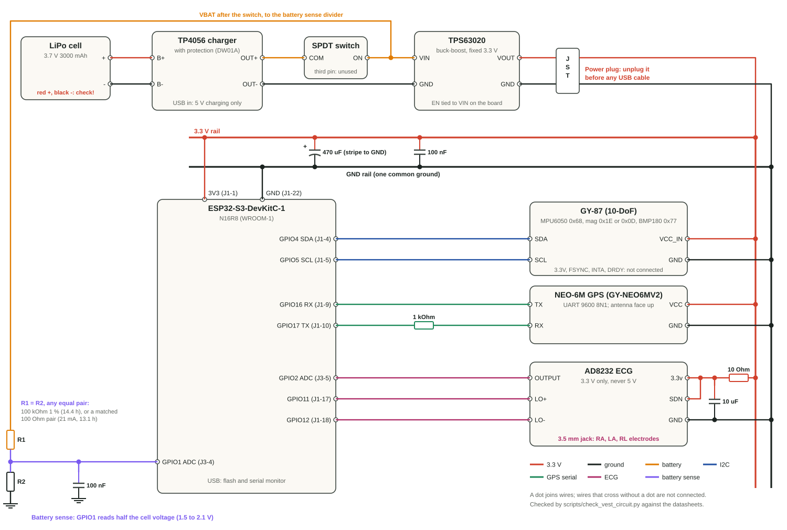

# Building the CPG44 vest, step by step

This guide takes you from a bag of modules to a working vest that streams a
chest ECG, motion and GPS to the CPG44 app. It assumes you can hold a
soldering iron and read a multimeter, nothing more. Every step ends with a
check, so a mistake is caught at the step that caused it.

The circuit was checked against the manufacturers' datasheets:

```bash
python scripts/check_vest_circuit.py
```

That script holds the whole circuit (every rail, part and wire) and tests 45
conditions at the worst-case voltages: supply ranges, logic levels, analog
input ranges, currents, battery life and pin choices. It also confirms the
pins below are the same ones the firmware uses. All 45 pass. Section 4 lists
the numbers and where each comes from.

Time needed: about one day, plus an overnight charge.

---

## 0. Five rules

1. **Never wear the electrodes while any USB cable is plugged into the vest**,
   whether to a laptop or a charger. USB connects the circuit to
   mains-powered equipment. Use the vest on its battery only.
2. **Unplug the power plug before plugging USB into the ESP32.** The power
   plug is the 2-pin connector between the TPS63020 and the rest of the
   circuit (Step 15). Espressif lists USB, the 5V pin and the 3V3 pin as
   "three mutually exclusive ways to provide power" to this board. Two at
   once can damage the board or the converter.
3. **The AD8232 is a 3.3 V part.** Its absolute maximum is 3.6 V and the
   board has no regulator. Never connect it to 5 V.
4. **Check the battery plug's polarity with a multimeter before connecting
   it to anything.** Many LiPo cells come with plugs wired the opposite way
   to the board they plug into. Reversed polarity destroys the charger.
5. **Switch the vest off to charge, and charge it out of the vest pocket** on
   a non-flammable surface. The charger gets hot at 1 A.

---

## 1. The circuit in one picture



In words:

- **Power.** The LiPo cell connects to the TP4056 charger. The charger's
  output goes through the slide switch to the TPS63020, which makes a steady
  3.3 V from any cell voltage between 3.0 and 4.2 V. The 3.3 V goes through a
  2-pin plug (the "power plug") to one 3.3 V rail and one ground rail. Every
  module takes its power from those two rails.
- **Motion.** The GY-87 talks to the ESP32 over I2C on two wires: SDA on
  GPIO 4, SCL on GPIO 5.
- **Position.** The GPS sends text at 9600 baud from its TX pin to GPIO 16.
  GPIO 17 sends setup commands back to its RX pin through a 1 kΩ resistor.
- **Heart.** The AD8232 turns the tiny voltage between two chest electrodes
  into a 0 to 3.3 V waveform on GPIO 2. Its LO+ and LO- pins go high on
  GPIO 11 and 12 when an electrode comes off.
- **Battery level.** Two equal resistors halve the switched battery voltage
  so GPIO 1 can measure it: 100 kΩ, or 100 Ω if that is what you have
  (Step 31).

---

## 2. Shopping list, A to Z

### 2a. Main modules (you have these)

| # | Item | Qty | What to check on yours | Job |
|---|---|---|---|---|
| 1 | ESP32-S3-DevKitC-1 with ESP32-S3-WROOM-1 **N16R8** | 1 | The metal can reads N16R8: 16 MB flash, 8 MB octal PSRAM | Reads the sensors and sends the data over Wi-Fi |
| 2 | GY-87 10-DoF board | 1 | 8 pins: VCC_IN, 3.3V, GND, SCL, SDA, FSYNC, INTA, DRDY | MPU6050 motion sensor and magnetometer |
| 3 | AD8232 ECG kit | 1 | Board pins: GND, 3.3v, OUTPUT, LO-, LO+, SDN; a 3.5 mm jack; a 3-lead cable with snaps marked RA, LA, RL | Chest ECG front end |
| 4 | NEO-6M GPS (GY-NEO6MV2) with ceramic antenna | 1 | 4 pins: VCC, RX, TX, GND; small coin cell and EEPROM chip on the board | Position and speed |
| 5 | TP4056 charger **with protection** | 1 | Six pads: IN+, IN-, B+, B-, OUT+, OUT-, plus two extra chips (DW01A, 8205A). A board with only 4 pads has no protection: replace it | Charges the cell; cuts off at 2.4 V and 4.3 V |
| 6 | TPS63020 buck-boost module, **fixed 3.3 V** | 1 | Pins VIN, GND, VOUT (some also EN) | Steady 3.3 V from 3.0 to 4.2 V |
| 7 | LiPo cell 3.7 V 3000 mAh, size 105050 | 1 | A small circuit board under the tape at the wire end (cell protection) | Power, about 14 hours |
| 8 | SPDT miniature slide switch | 1 | 3 pins; rated 0.5 A or more | On/off |
| 9 | Electrolytic capacitor 470 µF, 25 V | 1 | One leg longer (+), a stripe on the can (-) | Holds the 3.3 V rail up during Wi-Fi bursts |
| 10 | Resistor 100 kΩ, 1 % (or a matched pair of 100 Ω, see Step 31) | 2 | Bands brown, black, black, orange, brown; the meter reads 99 to 101 kΩ | Battery voltage divider |

### 2b. Small parts to buy

| # | Item | Qty | Notes |
|---|---|---|---|
| 11 | Ceramic capacitor 100 nF (marked 104) | 6 | ESP32 rail, GY-87, GPS, AD8232, battery sense, one spare |
| 12 | Capacitor 10 µF (ceramic, or electrolytic 16 V or more) | 2 | AD8232 supply filter, GPS supply |
| 13 | Resistor 10 Ω, 1/4 W | 1 | AD8232 supply filter |
| 14 | Resistor 1 kΩ, 1/4 W | 1 | In series with the GPS RX wire |
| 15 | JST-PH 2.0 mm 2-pin plug and socket pairs with leads | 3 | Battery, power plug, one spare |
| 16 | Female pin header strip, 2.54 mm, 40 pins | 2 | Sockets, so every module unplugs from the board |
| 17 | Male pin header strip, 2.54 mm, 40 pins | 1 | For modules that came without pins |
| 18 | Perfboard or stripboard, about 7 x 9 cm | 2 | One to build on, one spare |
| 19 | Silicone wire 24 AWG, red and black, 1 m each | 1 set | Power wiring |
| 20 | Silicone or PTFE wire 28 to 30 AWG, four colours, 2 m each | 1 set | Signal wiring |
| 21 | Heat-shrink tubing assortment | 1 | Insulate every joint |
| 22 | Kapton or electrical tape | 1 | Insulation under modules |
| 23 | Breadboard (830 points) and jumper wires (male-male, male-female) | 1 set | The trial build before soldering |

### 2c. For the body

| # | Item | Qty | Notes |
|---|---|---|---|
| 24 | Disposable Ag/AgCl gel snap electrodes | 50 | Three per session |
| 25 | Elastic chest strap (or an ECG chest strap with textile electrodes) | 1 | Holds the electrodes still while running |
| 26 | Compression vest or bib with a pocket between the shoulder blades | 1 | Carries the pod |
| 27 | Pod box about 90 x 55 x 20 mm (3D printed or ABS), foam, hook-and-loop tape | 1 | Protects the electronics |
| 28 | Alcohol wipes | 1 pack | Skin preparation for the electrodes |

### 2d. Cables and charger

| # | Item | Qty | Notes |
|---|---|---|---|
| 29 | USB **data** cable for the DevKit | 1 | Espressif's board has micro-USB; many copies have USB-C. A charge-only cable will not flash |
| 30 | USB cable for the TP4056 and a 5 V phone charger of 1 A or more | 1 | Charging only |

### 2e. Tools

| # | Tool | Notes |
|---|---|---|
| 31 | Temperature-controlled soldering iron | 330 to 350 °C |
| 32 | Solder 0.6 to 0.8 mm with flux core, and a flux pen | 63/37 leaded flows most easily |
| 33 | Solder wick or a desoldering pump | Fixing mistakes |
| 34 | **Multimeter** | DC volts, resistance and continuity (beep). You cannot do this build without one |
| 35 | Wire stripper for 24 to 30 AWG, flush cutters, tweezers, helping hands | |
| 36 | Heat gun or lighter for heat-shrink, hot glue gun | Strain relief |
| 37 | USB power meter (optional) | Shows the charging and running current |

### 2f. Not needed

- **MAX30102 pulse oximeter.** The chest ECG gives heart rate and heart-rate
  variability directly and keeps beat timing while running. The firmware
  does not read an optical sensor.
- **MAX17048 fuel gauge.** The divider on GPIO 1 measures the battery.
- **Level shifters.** Every part runs at 3.3 V logic (checked in section 4).
- **I2C pull-up resistors.** The GY-87 board has them.
- **A 5 V boost or a separate 3.3 V regulator.** The TPS63020 does the job.
- **A BMP180 or barometer module.** The one on the GY-87 is enough, and the
  firmware only checks that it is present.

---

## 3. Know each module

### ESP32-S3-DevKitC-1 (N16R8)

The board has two pin rows. Espressif calls the left row J1 and the right row
J3, seen with the USB ports at the bottom. Pin 1 is at the top of each row,
next to the antenna end. Clone boards follow the same layout; read the
printed labels to be sure.

| Pin | Header position | Connects to | Voltage | Signal |
|---|---|---|---|---|
| 3V3 | J1 pin 1 | 3.3 V rail | 3.3 V in (from the TPS63020) | Power |
| GND | J1 pin 22 (also J3 pins 1, 21, 22) | Ground rail | 0 V | Ground |
| GPIO 4 | J1 pin 4 | GY-87 SDA | 0 to 3.3 V | I2C data, 100 kHz |
| GPIO 5 | J1 pin 5 | GY-87 SCL | 0 to 3.3 V | I2C clock |
| GPIO 16 | J1 pin 9 | GPS TX | 0 to 3.3 V | Serial in, 9600 baud |
| GPIO 17 | J1 pin 10 | GPS RX (through 1 kΩ) | 0 to 3.3 V | Serial out, setup commands |
| GPIO 11 | J1 pin 17 | AD8232 LO+ | 0 or 3.3 V | High when an electrode is off |
| GPIO 12 | J1 pin 18 | AD8232 LO- | 0 or 3.3 V | High when an electrode is off |
| GPIO 1 | J3 pin 4 | Battery divider midpoint | 1.5 to 2.1 V | Analog, ADC1 channel 0 |
| GPIO 2 | J3 pin 5 | AD8232 OUTPUT | 0 to 2.9 V used | Analog, ADC1 channel 1, 250 samples a second |

**Pins never to use on this board:** GPIO 26 to 37 (internal flash, and the
octal PSRAM of the N16R8 on 35 to 37), 0, 3, 45 and 46 (start-up straps), 19
and 20 (USB), 43 and 44 (the USB-to-serial chip), 38 (RGB LED). Analog inputs
must be on ADC1 (GPIO 1 to 10) because ADC2 is shared with Wi-Fi.

**USB ports.** The board has two. The one marked **USB** goes to the ESP32's
own USB; the one marked **UART** (or COM) goes to a USB-to-serial chip.
Use the **USB** port: it both flashes and shows the start-up messages,
because the firmware sends its messages there.

### GY-87 (motion)

| Pin | Connect to | Notes |
|---|---|---|
| VCC_IN | 3.3 V rail | The board's own regulator gives the chips about 3.1 to 3.3 V |
| GND | Ground rail | |
| SDA | GPIO 4 | I2C, pulled up on the board |
| SCL | GPIO 5 | |
| 3.3V, FSYNC, INTA, DRDY | Nothing | Leave unconnected |

On the bus: MPU6050 at 0x68 and BMP180 at 0x77. The magnetometer differs
between batches: HMC5883L (0x1E), QMC5883L (0x0D) or, on recent boards such as
the one this guide was tested with, QMC5883P (0x2C). The firmware detects all
three and lists every address it finds. The HMC5883L only appears after the
firmware turns on the MPU6050's bypass mode.

### NEO-6M GPS (GY-NEO6MV2)

| Pin | Connect to | Notes |
|---|---|---|
| VCC | 3.3 V rail | The board's regulator feeds the receiver, rated 2.7 to 3.6 V |
| GND | Ground rail | |
| TX | GPIO 16 | 9600 baud, 8 data bits, no parity, 1 stop bit; 3.3 V logic |
| RX | GPIO 17 through 1 kΩ | The firmware sends u-blox (UBX) commands to switch to 5 fixes a second and keep only two sentences |

Data format: text lines (NMEA) such as `$GPRMC,...` with time, position,
speed and course, and `$GPGGA,...` with fix quality, satellites and HDOP.
Current: 39 mA tracking, 67 mA at most. The small LED blinks once a second
when it has a fix.

### AD8232 (ECG)

| Pin | Connect to | Notes |
|---|---|---|
| 3.3v | 3.3 V rail through 10 Ω, with 10 µF and 100 nF to ground at the pin | The filter keeps converter noise out of the ECG |
| GND | Ground rail | |
| OUTPUT | GPIO 2 | Analog ECG, rests at half the supply (about 1.65 V) |
| LO+ | GPIO 11 | Logic high when the RA or LA electrode is off |
| LO- | GPIO 12 | Logic high when the RA or LA electrode is off |
| SDN | 3.3 V (the filtered side) | Low would switch the chip off; tie it high |
| 3.5 mm jack | The 3-lead cable | Snaps marked RA, LA, RL |

The board amplifies the heart's signal about 1100 times and filters it to
about 0.5 to 40 Hz. A 1 mV R wave becomes about 1.1 V above the resting level.

### TP4056 charger

| Pad | Connect to | Notes |
|---|---|---|
| B+ / B- | Battery + / - | Through the battery's JST plug |
| OUT+ | Switch, middle pin | The protected battery output |
| OUT- | TPS63020 GND | |
| IN+ / IN- or the USB socket | 5 V charger | Use the USB socket |

LEDs: red while charging, blue or green when full. It charges at 1 A to
4.2 V; an empty 3000 mAh cell takes about 3.5 hours.

### TPS63020 converter

| Pin | Connect to | Notes |
|---|---|---|
| VIN | Switch, outer pin | 1.8 to 5.5 V in |
| GND | TP4056 OUT- | |
| VOUT | Power plug, then the 3.3 V rail | Fixed 3.3 V, up to 2 A |
| EN (if present) | VIN | Most boards already tie it; Step 12 tells you if yours does not |

---

## 4. The checked numbers

| What | Value | Limit | Source |
|---|---|---|---|
| ESP32-S3 supply | 3.20 to 3.40 V | 3.0 to 3.6 V | ESP32-S3-WROOM-1 datasheet, table 6-2 |
| Supply the ESP32 needs to be able to deliver | 2 A available | at least 0.5 A | same table |
| ESP32 Wi-Fi transmit peak | 355 mA | | table 6-4 |
| AD8232 supply | 3.20 to 3.40 V | 2.0 to 3.5 V (3.6 V absolute) | AD8232 datasheet |
| MPU6050 supply (behind the GY-87 regulator) | 3.05 to 3.40 V | 2.375 to 3.46 V | MPU-6050 product specification |
| NEO-6M supply (behind its regulator) | 3.05 to 3.40 V | 2.7 to 3.6 V | u-blox NEO-6 datasheet |
| TPS63020 input | 3.0 to 4.2 V | 1.8 to 5.5 V, 2 A out at 3.3 V | TI TPS63020 datasheet |
| GPS TX high, read by the ESP32 | 2.65 V or more | ESP32 needs 2.55 V | NEO-6 (VCC - 0.4 V at 4 mA); ESP32 0.75 x VDD |
| ESP32 TX into the GPS RX | 3.40 V at most | 3.6 V absolute | NEO-6 datasheet |
| Battery voltage on GPIO 1 | 1.48 to 2.12 V | ADC reads 0 to 2.9 V at 12 dB | ESP32-S3 datasheet, ADC table |
| ECG on GPIO 2 | rests at 1.65 V, R wave up to about 2.8 V | 2.9 V | same |
| Battery reading error | ±0.14 V at worst | | ADC ±50 mV, doubled, plus 1 % resistors |
| Current at 3.3 V | 170 mA average, 436 mA peak | 2 A | sum of the datasheet currents |
| Current from the cell | 177 mA average, 564 mA peak | protection trips near 3 A | DW01A datasheet |
| Dip during a Wi-Fi burst | 38 mV with the 470 µF | the ESP32 resets near 2.7 V | |
| Running time | about 14 hours (about 13 with a 100 Ω divider) | | 3000 mAh, 85 % usable, 88 % converter efficiency |
| Battery divider current | 0.02 mA (100 kΩ pair), 21 mA (100 Ω pair) | 1/4 W per resistor | 100 Ω pair: 44 mW each |
| Charge time | about 3.6 hours | | TP4056 at 1 A |

Run `python scripts/check_vest_circuit.py` to see all 45 checks with margins.

---

## 5. Build it

Do the whole build on a breadboard first (Phases A to G), with every check
passing, then move it to perfboard (Phase H). A breadboard mistake costs a
minute; a soldered one costs an hour.

### Phase A: prepare

**Step 1. Lay out and label.** Put each module on the bench and write its
name on a piece of tape. Solder male header pins to any module that came
without them (short side into the board, iron on the pad and the pin together
for two seconds, feed solder, remove the solder, then the iron).

**Step 2. Measure the resistors.** Set the meter to resistance. The 100 kΩ
pair should read 99 to 101 kΩ, the 10 Ω about 10 Ω, the 1 kΩ about 1 kΩ.
If you are using 100 Ω resistors for the battery divider, measure several and
keep the two closest to each other (within 1 Ω). Bend each into a small
labelled card.

**Step 3. Find the capacitor polarity.** On the 470 µF can, the stripe with
minus signs marks the negative leg, which is also the shorter one. The
ceramic 100 nF and 10 µF capacitors have no polarity (if your 10 µF is an
electrolytic, it has a stripe too).

**Step 4. Check the battery.** Set the meter to DC volts (20 V range). Touch
red to the battery's red wire and black to its black wire.
*Check:* 3.6 to 4.2 V. A new cell usually reads about 3.7 to 3.9 V. Below
3.0 V, do not use it.

**Step 5. Check the battery plug against the charger's plug.** If the battery
has a JST plug and you are using a JST socket on the charger side, measure
which socket pin will meet the battery's red wire. It must be the pin wired
to **B+**. If it is the other way round, swap the two wires on the socket
side (or cut and resolder), never on the battery.

**Step 6. Identify the switch pins.** Set the meter to continuity. The
middle pin beeps to one outer pin in one position and to the other outer pin
in the other position. The middle pin is the common (COM). Choose one outer
pin as ON and mark it; leave the other unused.

### Phase B: power

**Step 7. Battery to charger.** Connect battery + to **B+** and battery - to
**B-** on the TP4056 (through the JST pair from Step 5).
*Check:* measure OUT+ to OUT-: the same as the battery voltage (within
0.05 V). If it reads 0 V, the protection may be asleep after a deep
discharge: plug in the USB charger for a few seconds to wake it.

**Step 8. Test charging.** Plug the TP4056 into a phone charger.
*Check:* the red LED lights. With a USB power meter, the current is about
0.8 to 1.0 A for a part-charged cell. Unplug it again for now. (Charge it
fully later, overnight or for about four hours.)

**Step 9. Switch.** Solder a red 24 AWG wire from **OUT+** to the switch
**COM** pin, and another from the switch **ON** pin to the TPS63020 **VIN**.
Solder a black 24 AWG wire from **OUT-** to the TPS63020 **GND** (input
side). Cover every joint with heat-shrink.

**Step 10. First power-on of the converter, with nothing else attached.**
Switch ON.
*Check:* TPS63020 VOUT to GND reads **3.25 to 3.35 V** (3.20 to 3.40 V is
within the design).

**Step 11. Switch OFF.**
*Check:* VOUT reads 0 V within a second or two, and VIN reads 0 V.

**Step 12. If Step 10 gave 0 V:** check the switch position and VIN first. If
VIN has the battery voltage but VOUT stays at 0 V and your board has an EN pin,
connect EN to VIN and repeat Step 10.

**Step 13. Bulk capacitor.** On the breadboard, make a 3.3 V rail (red row)
and a ground rail (blue row). Put the 470 µF across them: **long leg (+) to
3.3 V, stripe (-) to ground.** Put a 100 nF next to it.

**Step 14. Short-circuit test before connecting the rails.** Set the meter to
resistance and measure between the 3.3 V rail and the ground rail.
*Check:* the reading climbs from a low value to more than 1 kΩ within a few
seconds (the capacitor charging from the meter). A steady 0 Ω means a short:
find it before going on.

**Step 15. Power plug.** Solder a JST socket to TPS63020 VOUT (red) and GND
(black), and the matching plug to the 3.3 V and ground rails. This is the
power plug from rule 2. With the switch OFF, connect it.
*Check:* switch ON; the rails read 3.25 to 3.35 V. Switch OFF.

### Phase C: the ESP32 on its own

**Step 16. Install the software (once).** On the laptop, install the CPG44
app (see `RUNNING.md`). The **Flash a vest** page builds and uploads the
firmware with `arduino-cli`. It needs the ESP32 core and four libraries; if
the page reports any missing, run:

```bash
arduino-cli core install esp32:esp32
```

```bash
arduino-cli lib install "Adafruit MPU6050" "ArduinoJson" "TinyGPSPlus"
```

(Adafruit MPU6050 brings Adafruit Unified Sensor and Adafruit BusIO with it.)

**Step 17. Prepare the relay certificates (once, and again if flashing fails
with a certificate error).**

```bash
bash scripts/prepare_relay_ca.sh
```

*Check:* it ends with "cpg44.nivaspms.com verifies against them."

**Step 18. Flash.** Rails unplugged, battery switched OFF, nothing else on the
ESP32. Plug a USB data cable into the ESP32's **USB** port. On **Flash a
vest**, pick the port, enter the player number, the Wi-Fi name and password,
and flash.
*Check:* the page reports success. Open the serial monitor (115200 baud) on
the same port and press the board's **RST** button. You should see:

```text
=== CPG44 ESP32-S3 VEST: ECG, IMU, GNSS ===
GY-87 MPU6050 0x68: MISSING
GY-87 BMP180  0x77: MISSING
MPU6050 FAILED
NEO-6M UART started, 5 Hz RMC+GGA requested
AD8232 ECG sampling at 250 Hz
```

"MISSING" is right at this stage: nothing is connected yet. If you see
"Provisioning required", the flash did not include the Wi-Fi and relay
settings: flash again from the app.

From now on the **Bench check** panel on the same page shows every part's
state, read from a line the vest prints every 2 seconds over USB, with what to
do for each one that is not green. No Wi-Fi or app connection is needed for
it. If the vest cannot join its Wi-Fi, it lists the 2.4 GHz networks it can
see there.

**Step 19. Run the ESP32 from the battery.** Unplug USB. Wire the 3.3 V rail
to **3V3 (J1 pin 1)** and the ground rail to **GND (J1 pin 22)**. Connect the
power plug and switch ON.
*Check:* the board's power LED lights, and 3V3 to GND on the board reads 3.25
to 3.35 V. With the app running on the laptop (`scripts/start_system.sh`),
the **Vest readings** page shows the vest as connected within about 20
seconds. Movement shows "none" until the GY-87 is fitted, and the battery is
not reported until Phase G.

From now on, before any USB work: **switch OFF and unplug the power plug.**

### Phase D: GY-87

**Step 20.** Switch OFF. Wire GY-87 **VCC_IN** to the 3.3 V rail, **GND** to
ground, **SDA** to **GPIO 4 (J1 pin 4)**, **SCL** to **GPIO 5 (J1 pin 5)**.
Put a 100 nF across VCC_IN and GND at the module.

**Step 21.** Switch ON.
*Check with the meter:* SDA and SCL each read about 3.1 to 3.3 V to ground
(the pull-ups). 0 V means a short or the wrong pin.

**Step 22.** Switch OFF, unplug the power plug, connect USB, open the serial
monitor and press RST.
*Check:*

```text
GY-87 MPU6050 0x68: FOUND
GY-87 BMP180  0x77: FOUND
MPU6050 ready
HMC5883L magnetometer ready      (or QMC5883L or QMC5883P)
```

"No magnetometer found" is not fatal; heading is simply unavailable.

### Phase E: GPS

**Step 23.** Unplug USB. Wire GPS **VCC** to 3.3 V, **GND** to ground, GPS
**TX** to **GPIO 16 (J1 pin 9)**, and **GPIO 17 (J1 pin 10)** through the
**1 kΩ** resistor to GPS **RX**. Add a 10 µF and a 100 nF across VCC and GND
at the module. Connect the power plug and switch ON.
*Check:* GPS VCC reads 3.25 to 3.35 V. GPS TX reads about 3 V on the meter
(the line idles high).

**Step 24.** Take the vest outdoors, antenna facing the sky. A cold start
takes 30 seconds to a few minutes.
*Check:* the GPS LED starts blinking once a second. On **Vest readings**,
"GNSS fixes" rises towards 100 % and Speed and Distance show values.

### Phase F: AD8232 ECG

**Step 25.** Switch OFF. Build the supply filter: 3.3 V rail, then the **10 Ω**
resistor, then the AD8232 **3.3v** pin. From that pin, put the **10 µF** and
a **100 nF** to ground. Wire AD8232 **SDN** to the same filtered 3.3 V point.

**Step 26.** Wire AD8232 **GND** to ground, **OUTPUT** to **GPIO 2 (J3 pin
5)**, **LO+** to **GPIO 11 (J1 pin 17)**, **LO-** to **GPIO 12 (J1 pin 18)**.
Keep the OUTPUT wire short and away from the TPS63020.

**Step 27.** Switch ON, no electrodes yet.
*Check:* the AD8232 3.3v pin reads 3.25 to 3.35 V. LO+ or LO- reads about
3.3 V (electrodes off). On **Vest readings**, Electrodes shows **Off**.

**Step 28. Put on the electrodes** (one person wears it; the vest runs on
battery only, rule 1). Clean the skin with an alcohol wipe and let it dry.
Snap the cable to three fresh gel electrodes, reading the **label** on each
snap, because cable colours differ between makers:

- **RA:** right side of the chest, level with the bottom of the breastbone,
  a hand's width from the middle.
- **LA:** left side, at the same level and distance.
- **RL:** lower right ribs, a hand's width below RA (the reference).

This is the position a chest strap uses, so the gel electrodes can later be
replaced by a strap with textile electrodes. Plug the cable into the jack.

**Step 29.** Sit still for 15 seconds.
*Check:* on **Vest readings**, Electrodes shows **On**, the ECG strip shows a
clear spike for every beat with a tick above each, and the heart rate
appears. Count your pulse at the wrist for 30 seconds and double it: the two
should agree within 5 bpm. After 30 seconds still, Variability (RMSSD)
appears.

**Step 30.** Pull one electrode off.
*Check:* within two seconds Electrodes shows **Off** and the heart rate
disappears instead of showing a wrong number. Press it back on: the rate
returns within about 15 seconds (the hub waits for a full 10 s window of clean
signal).

### Phase G: battery sense

**Step 31.** Switch OFF. From the **switched** battery line (TPS63020 VIN,
after the switch, not before it) wire one resistor (R1) to a midpoint, and the
second (R2) from the midpoint to ground. Wire the midpoint to **GPIO 1 (J3 pin
4)** and put a **100 nF** from the midpoint to ground.

R1 and R2 must be equal; their value only sets how much current the divider
uses. Any of these works, with no firmware change:

| R1 and R2 | Current while on | Running time | Notes |
|---|---|---|---|
| 100 kΩ each (design) | 0.02 mA | about 14.4 h | Best |
| 100 Ω each, a matched pair | 21 mA | about 13.1 h | 44 mW per resistor, fine for 1/4 W parts |
| Five 100 Ω in series on each side (500 Ω) | 4 mA | about 14.1 h | Needs ten resistors |

Why after the switch: when the vest is off, no current flows through the
divider and no voltage reaches the unpowered ESP32 pin. With 100 Ω this is
essential, not just tidy: wired before the switch, a 100 Ω pair would empty
the cell in about 6 days with the vest switched off and over-discharge it.

Why matched: the firmware doubles the midpoint voltage. Two 100 Ω parts from a
5 % batch can differ enough to put the reading 0.2 V off, which makes the
percentage wrong. Two that measure within 1 Ω of each other keep it within the
usual 0.15 V. With 100 Ω the 100 nF capacitor is optional; keep it if you have
it.

**Step 32.** Switch ON.
*Check:* the midpoint reads half the battery voltage (3.9 V battery gives
1.95 V). On **Vest readings**, the battery percentage appears. Compare the
cell voltage measured with the meter to the vest's figure: they agree
within 0.15 V.

**Step 33. Full check on the breadboard.** Everything connected, on battery,
outdoors, electrodes on.
*Check:* **Samples arriving** shows Movement, ECG and GNSS near 100 %; the
ECG strip is clean; the battery percentage is steady. Leave it running for
ten minutes: nothing drops out.

### Phase H: move to perfboard

**Step 34. Plan the board.** Place sockets (female headers) for the
ESP32 (two rows of 22, matching the board's spacing), GY-87 (8), GPS (4) and
AD8232 (6). Modules plug in, so one can be swapped without desoldering.
Keep the AD8232 at the end farthest from the TPS63020, and the GPS at the
top edge so its antenna can face up out of the pod. Keep the ESP32's antenna
end clear of wires and metal.

**Step 35. Power first.** Solder the two rails (red and black 24 AWG along
the board), the 470 µF and 100 nF next to the ESP32's 3V3 and GND sockets,
and the power-plug socket. Repeat Step 14 (no short) and Step 15 (3.25 to
3.35 V on the rails) before plugging in any module.

**Step 36. One ground point.** Bring every module's ground back to the rail
near the ESP32 rather than chaining ground from module to module. The ECG
reference is only a few millivolts, so ground currents from the GPS and Wi-Fi
must not flow through the AD8232's ground wire.

**Step 37. Signals, one at a time.** Solder the wires of Phases D to G in the
same order, with the same checks after each. Keep signal wires short; twist
the AD8232 OUTPUT wire with a ground wire if it is longer than 10 cm.

**Step 38. Continuity check.** With everything unplugged, beep out every wire
in the pin table in section 3 from socket to socket. Then check that no
neighbouring pins beep to each other.

**Step 39. Plug in the modules and repeat Step 33.**

### Phase I: into the vest

**Step 40. Pod.** Put the board in the pod with foam under it, the GPS
antenna facing up through the lid (plastic only above it), the switch
reachable through a slot, and the TP4056's USB socket reachable for charging.
Hot-glue the battery wires and the ECG cable where they leave the board so a
tug pulls on the glue, not the solder.

**Step 41. Battery.** In its own padded section of the pod, never pressed
against the board's sharp pins.

**Step 42. Wear it.** The pod goes in the pocket between the shoulder
blades. Route the ECG cable under the arm and fix it to the vest every 10 cm:
a swinging cable is the biggest source of ECG noise. The chest strap holds
the electrodes.

---

## 6. Test-point cheat sheet

| Point | Expected | If not |
|---|---|---|
| Battery + to - | 3.0 to 4.2 V | Charge it; below 3.0 V replace it |
| TP4056 OUT+ to OUT- | Battery voltage | 0 V: plug in the charger to reset the protection |
| TPS63020 VIN (switch ON) | Battery voltage | Switch pins wrong (Step 6) |
| 3.3 V rail | 3.25 to 3.35 V | 0 V: EN pin (Step 12); low: overload or short |
| ESP32 3V3 pin | Same as the rail | Power plug or wire |
| GY-87 SDA and SCL, idle | 3.1 to 3.3 V | 0 V: short or wrong pin |
| GPS TX, idle | About 3 V | 0 V: GPS not powered |
| AD8232 OUTPUT, electrodes on | Wavering around 1.65 V | Stuck near 0 or 3.3 V: electrode or cable |
| AD8232 LO+ / LO- | 0 V with electrodes on, 3.3 V with one off | Always high: an electrode is not touching |
| GPIO 1 | Half the battery voltage | Divider wired before the switch, or a resistor value wrong |

## 7. Troubleshooting

| Symptom | Likely cause | Fix |
|---|---|---|
| Flashing fails, no port appears | Charge-only USB cable, or the UART port without its driver | Use a data cable in the port marked USB |
| Serial monitor shows nothing | Messages printed before the monitor opened | Press RST with the monitor open |
| "Provisioning required" | Flashed without Wi-Fi and relay settings | Flash from the app's Flash a vest page |
| Vest never shows connected | Wrong Wi-Fi password, 5 GHz-only network, or a captive portal | The ESP32 needs a 2.4 GHz network without a login page (a phone hotspot works) |
| "certificate verify failed" in the app or vest log | Old relay certificate file | Run Step 17 again, then reflash |
| Board resets when Wi-Fi starts | Missing or reversed 470 µF, or long thin power wires | Fit the 470 µF at the ESP32 pins, 24 AWG power wires |
| MPU6050 MISSING | SDA and SCL swapped, or VCC_IN not powered | Recheck Step 20 and 21 |
| No GPS fix after 5 minutes | Indoors, or antenna covered by metal or the body | Outdoors, antenna up, nothing above it |
| ECG flat, Electrodes "Off" | Cable not fully in the jack, or dry electrodes | Push the plug fully in; fresh electrodes, clean skin |
| ECG noisy while still | Cable swinging, or ground shared with the GPS | Tape the cable; separate ground wire (Step 36) |
| Heart rate missing only while running | Electrodes slipping | Tighter chest strap; wet textile electrodes |
| Battery percentage jumps | Divider before the switch, or no 100 nF on GPIO 1 (with 100 kΩ resistors) | Step 31 |
| Battery level clearly wrong | R1 and R2 not equal | Measure both; use a matched pair (Step 31) |
| Battery drains while the vest is off | Divider wired before the switch | Move it after the switch (Step 31) |
| Charger LED never turns blue or green | Vest switched on while charging | Switch off to charge (rule 5) |

## 8. Calibration before each session

| Sensor | What to do | Time |
|---|---|---|
| Gyroscope | Lay the vest flat and still | 2 s |
| Accelerometer | Rest the pod still on each of its six faces | 15 s, once per pod |
| Magnetometer | Turn the pod slowly through a figure eight, away from metal | 20 s |
| ECG | Compare the vest's heart rate with a 30 s wrist count | 30 s |

The hub saves the accelerometer and gyroscope results, so the six faces are
needed only once per pod. The **Vest readings** page shows the state of each.

## 9. References

- [ESP32-S3-DevKitC-1 v1.1 user guide](https://docs.espressif.com/projects/esp-dev-kits/en/latest/esp32s3/esp32-s3-devkitc-1/user_guide_v1.1.html): power options, header pins, GPIO 35 to 37 with octal PSRAM, USB ports.
- [ESP32-S3-WROOM-1 datasheet](https://documentation.espressif.com/esp32-s3-wroom-1_wroom-1u_datasheet_en.pdf): supply range, logic levels, Wi-Fi current.
- [ESP32-S3 series datasheet](https://documentation.espressif.com/esp32-s3_datasheet_en.pdf): ADC effective range 0 to 2900 mV at 12 dB.
- [TI TPS63020](https://www.ti.com/product/TPS63020): input range, 2 A at 3.3 V, load disconnect.
- [Analog Devices AD8232](https://www.analog.com/en/products/ad8232.html): supply 2.0 to 3.5 V, leads-off detection.
- [u-blox NEO-6 datasheet](https://content.u-blox.com/sites/default/files/products/documents/NEO-6_DataSheet_%28GPS.G6-HW-09005%29.pdf): supply 2.7 to 3.6 V, current, 5 Hz.
- TP4056 and DW01A datasheets: 4.2 V charge, 1.2 kΩ for 1 A, protection at 4.3 V, 2.4 V and about 3 A.
- [Cloudflare certificate authorities](https://developers.cloudflare.com/ssl/reference/certificate-authorities/): why the vest trusts roots, not a captured chain.
