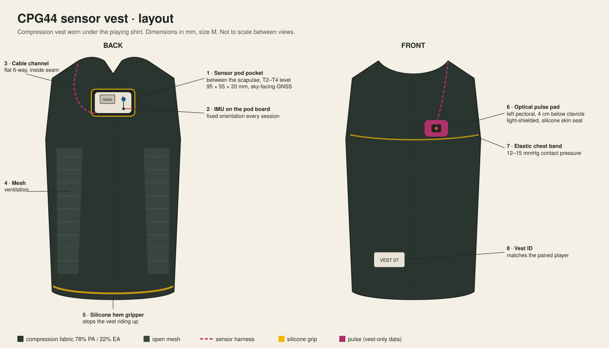
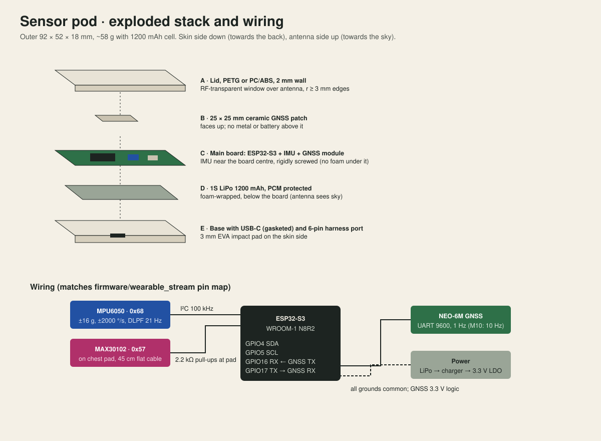

# CPG44 sensor vest: design specification

Status: design for the next build. The current prototype (ESP32-S3 + MPU6050 +
MAX30102 + NEO-6M, `firmware/wearable_stream`) is functional on a bench
harness; this document turns it into something a player can wear for a full
session. Every requirement below is traced to a measured problem or a cited
source. Reference numbers in brackets point to [docs/REFERENCES.md](../REFERENCES.md).

## 1. What the vest must do (from the report objectives)

| Need | Comes from | Design consequence |
|---|---|---|
| External load: acceleration, PlayerLoad, impacts | Objective 2; `catapult.py`, `coach_engine.py` | IMU rigidly fixed to the trunk, same orientation every session, ±16 g / ±2000 °/s range |
| Position cross-check outside the camera view | Objective 2; `sensors/gps_pitch.py` | GNSS antenna facing the sky, nothing metallic above it |
| Internal load: heart rate (SpO2 only at rest) | Objective 2; `sensors/hub.py`, `motion_artifact.py` | Optical sensor pressed on skin, shielded from light, close to a stable trunk site |
| Pairing with the right player | Objective 1; `sync.py`, review queue | Visible vest ID matching the roster; same pod always in the same vest |
| Full training session or match | Field use | ≥ 2 h battery with margin; sweat and impact tolerant |
| Must not hurt anyone | Safety; FIFA EPTS / IFAB Law 4 [V5] | No hard edges, no exposed battery, pod on the back where players rarely land |

## 2. Placement and why

**Pod between the shoulder blades (T2, T4).** This is where professional
GNSS/IMU devices are worn [V1, V2]: the trunk moves as one segment there, the
antenna sees the sky over the head, and it is the area least likely to take a
direct blow. Validity studies of vest-worn 10 Hz units report acceptable
distance and peak-speed accuracy in this position [V1], with the caveat that
stadium stands degrade GNSS [V1]. Trunk placement measures whole-body load,
not limb kinematics [V3]; that is the intended scope.

**Optical pulse pad on the left upper chest (pectoral), not on the back pod.**
Reflective PPG needs firm skin contact and low local motion. On the upper back
the pod moves with the scapulae and sits on thin, poorly perfused skin. The
chest under a compression band is a recognised trunk PPG site, and the
accelerometer-referenced NLMS filter in `sensors/motion_artifact.py` assumes
the IMU and the pulse site share trunk motion. The pad connects to the pod by a
45 cm flat 6-way cable routed inside the left shoulder seam (I²C, 2.2 kΩ
pull-ups at the pad end; add a P82B715 bus extender if the cable grows longer).

**Not on the wrist.** Wrist PPG is the most motion-corrupted site during
running [V4]; a wrist strap is also a contact hazard in football.

## 3. Garment

| Item | Specification |
|---|---|
| Fabric | Warp-knit compression, ~78 % polyamide / 22 % elastane, 200-230 g/m², 4-way stretch |
| Fit | Sized S, XL; target 12-15 mmHg at the chest band so the pad stays seated without restricting breathing |
| Back pocket | 95 × 55 × 20 mm, double-layer with TPU-laminated mouth, opening at the top so the pod cannot drop out |
| Ventilation | Open mesh panels down both flanks (heat is the main comfort complaint with vests) |
| Hem | 25 mm silicone gripper so the vest does not ride up and rotate the IMU |
| Harness channel | Flat-lock seam tunnel over the left shoulder; cable never crosses the spine |
| ID | Printed vest number on the front hem and inside the pocket, matching the roster pairing |
| Care | Pod and pad removable; garment machine-washable at 30 °C |

## 4. Pod enclosure

- Outer 92 × 52 × 18 mm, target mass ≤ 60 g with the battery.
- Two-part shell (PETG or PC/ABS, 2 mm wall), all external radii ≥ 3 mm,
  silicone O-ring gasket (IP54 target), gasketed USB-C.
- Stack (top to bottom): lid with RF-transparent window → ceramic GNSS patch →
  main board → foam-wrapped LiPo → base with 3 mm EVA pad on the skin side.
  The battery sits *below* the board so it never shadows the antenna.
- The IMU is screwed rigidly to the board near its centre; never mount it on
  foam (foam adds a resonance that looks like player movement).

## 5. Electronics

| Block | Current part | Recommended upgrade | Reason |
|---|---|---|---|
| MCU / radio | ESP32-S3-WROOM-1 | same | Wi-Fi TLS to the relay is already proven |
| IMU | MPU6050, now ±16 g, ±2000 °/s, DLPF 21 Hz | ICM-42688-P | Lower noise, on-chip anti-alias filter, 32 g option for impacts |
| PPG | MAX30102 | MAX86141 AFE + separate LEDs/PD | Higher dynamic range and ambient rejection under motion |
| GNSS | NEO-6M, 1 Hz | u-blox MAX-M10S, 10 Hz multi-GNSS | 1 Hz aliases 1-2 s sprints; 10 Hz is the field standard [V1] |
| Power | 1S LiPo + linear charger + 3.3 V LDO | add MAX17048 fuel gauge | Battery % in the vest status, early low-battery warning |

Firmware changes already made in this pass: accelerometer range ±8 g → ±16 g,
gyro ±1000 → ±2000 °/s, and the on-chip low-pass 44 Hz → 21 Hz. The sketch
samples at 50 Hz, so the old 44 Hz filter let impact and vibration energy
above 25 Hz alias into the stride band and into the PPG motion reference.

### Power budget (current parts, Wi-Fi streaming)

| Load | Typical current |
|---|---|
| ESP32-S3, Wi-Fi TX bursts averaged | 100-130 mA |
| NEO-6M tracking | ~45 mA |
| MAX30102 (LED 60/255, 100 sps) | 2-6 mA |
| MPU6050 | ~4 mA |
| Regulator/quiescent | ~2 mA |
| **Total** | **≈ 155-190 mA** |

A 1200 mAh cell gives roughly 5-6.5 h after derating to 80 % usable capacity,
comfortably above a 2 h session. Measure on the bench with a USB power meter
before relying on these numbers.

## 6. Data and timing

- Raw IMU (50 Hz), PPG (25 Hz) and GNSS (1 Hz) are batched and sent through the
  authenticated relay; the laptop computes everything (no on-device "health"
  numbers that cannot be audited).
- Source timestamps come from SNTP-anchored device time; the hub preserves
  them and maps them to the host clock (`ClockMapper`).
- Synchronisation check at the start and end of every session: the player
  jumps on the spot in camera view; the IMU vertical peak and the video frame
  of take-off give the offset (protocol: `docs/CAPSTONE_ACCURACY_PROTOCOL.md`).

## 7. Safety checklist

- No rigid part on the front of the body; the chest pad is soft silicone around
  a 10 × 10 mm sensor.
- Battery with protection circuit, inside a foam wrap, never charged inside
  the vest.
- Skin-contact materials: medical-grade silicone on the pad; check for
  irritation after the first sessions.
- Referees must be told; in competition only approved EPTS devices may be worn
  [V5].
- Heart-rate and workload outputs are coaching cues, not medical diagnoses.

## 8. Validation before any claim

| Test | Pass condition |
|---|---|
| Drop from 1.5 m onto turf, 10 times | Pod intact, data continues |
| 90 min wear, sprint drills | No pod rotation > 10° (IMU gravity vector), no skin marks |
| Wash 20 cycles (garment only) | Pocket and harness channel intact |
| HR vs chest-strap ECG (Polar H10), rest / jog / sprint / recovery | MAE ≤ 5 bpm in jog, abstains during sprint artefact |
| GNSS vs measured 30 m lane | Distance error reported with CI |
| Clock sync jump test | Offset ≤ 100 ms after mapping |

## 9. Bill of materials (prototype, approximate INR, Nov 2026)

| Part | Qty | Approx. |
|---|---|---|
| ESP32-S3-WROOM-1 dev board | 1 | 700 |
| MPU6050 module (upgrade: ICM-42688-P breakout ~900) | 1 | 150 |
| MAX30102 module | 1 | 250 |
| NEO-6M module + 25 mm patch (upgrade: MAX-M10S ~2,200) | 1 | 450 |
| 1S LiPo 1200 mAh with PCM | 1 | 450 |
| Charger + LDO + fuel gauge | 1 | 250 |
| 3D-printed enclosure, gasket, EVA pad | 1 | 300 |
| Compression vest (sports, modified with pocket and channel) | 1 | 900 |
| Silicone pad, flat cable, connectors | 1 | 250 |
| **Total per vest** | | **≈ 3,700** (≈ 6,500 with upgrades) |
